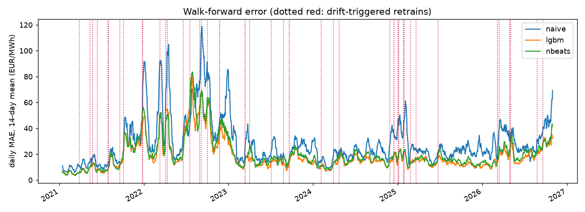
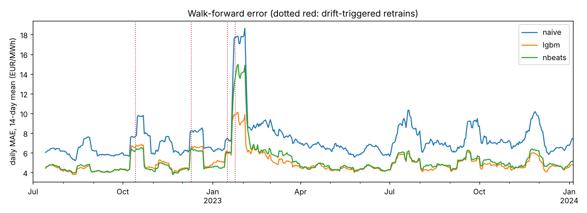

# dayahead-epf

Day-ahead electricity price forecasting (LightGBM, N-BEATS) with walk-forward backtesting and drift-triggered retraining.

[](https://github.com/TomDaniaud/dayahead-epf/actions/workflows/ci.yml)


Forecasts the 24 hourly prices of the next day's power auction. The project focuses on three questions:

1. **How accurate is the model, day after day, using only information available before gate closure?** -> walk-forward backtest with no data leakage
2. **Is it really better than a simple benchmark?** -> standard forecast KPIs and a statistical significance test
3. **When should the model be retrained?** -> automatic detection of performance drift that triggers retraining

---

## At a glance

| | |
|---|---|
| **Problem** | Forecast the 24 hourly day-ahead prices of day D, at D-1 before the 12:00 auction gate closure |
| **Data** | ENTSO-E Transparency Platform: day-ahead prices + day-ahead load, wind and solar forecasts (studied on France, any bidding zone works) |
| **Models** | Naive benchmark · LightGBM · N-BEATS with exogenous inputs (PyTorch) |
| **Evaluation** | Daily walk-forward backtest · MAE, RMSE, rMAE, bias, tail error · Diebold-Mariano test |
| **Monitoring** | Page-Hinkley drift detection on daily errors -> retraining; PSI on input features |
| **Engineering** | Installable package · CLI · 22 unit tests incl. leakage tests · ruff · GitHub Actions CI |

## Quick start

```bash
git clone https://github.com/TomDaniaud/dayahead-epf.git && cd dayahead-epf
pip install -e ".[deep,dev]"
pytest -q          # 22 tests, ~30 s
epf demo           # full benchmark on a synthetic market, no API key needed (~1 min)
```

On real data (free ENTSO-E API token):

```bash
pip install -e ".[entsoe]"
export ENTSOE_API_KEY=...
epf download --country FR --start 2019-01-01 --end 2026-11-01 --out data/fr.csv   # ~12 min, years fetched in parallel
epf backtest --data data/fr.csv --models naive,lgbm,nbeats --test-start 2021-01-01 --retrain periodic+drift   # ~9 min
```

Each run writes to `results/`, or to the folder given by `--out`: a KPI table, hourly forecasts per model, the retraining log (date, reason, drift statistics) and an error plot. Hourly forecasts are not tracked in git.

## Results (France, real data)

Walk-forward backtest on ENTSO-E data over **2,123 delivery days, from January 2021 to October 2026**, including the 2022 energy crisis. Training uses a 2-year rolling window, so 2019-2020 only serve as the first training set.

Models retrained every 30 days:

| Model | MAE (€/MWh) | rMAE vs naive | Significantly better than naive? |
|---|---|---|---|
| Naive benchmark | 28.99 | 1.00 | - |
| **LightGBM** | **18.62** | **0.64** | yes, p < 0.001 |
| N-BEATS | 20.05 | 0.69 | yes, p < 0.001 |

LightGBM is also significantly better than N-BEATS (p < 0.001). Its lead over the benchmark holds every year:

| MAE (€/MWh) | 2021 | 2022 | 2023 | 2024 | 2025-26 |
|---|---|---|---|---|---|
| Naive benchmark | 20.09 | 53.09 | 23.49 | 21.75 | 27.68 |
| LightGBM | 14.33 | 35.53 | 14.86 | 13.91 | 16.38 |

Retraining policy comparison:

| Policy | LightGBM MAE | Retrains | N-BEATS MAE | Retrains |
|---|---|---|---|---|
| Never retrain | 26.00 | 1 | 23.95 | 1 |
| On drift only | 19.61 | 15 | 21.58 | 18 |
| **Every 30 days** | **18.62** | **71** | **20.05** | **71** |
| Every 30 days + on drift | 18.64 | 78 | 20.10 | 78 |

The retrain counts include the initial training.

**Takeaways:**

- **Retraining is essential.** Every policy beats never retraining (p < 0.001).
- **A monthly schedule is hard to beat.** It is significantly better than drift-only retraining for both models, and adding drift alarms to it brings no measurable gain (p > 0.3).
- **Drift-only is a cheaper option, with a cost in accuracy.** For LightGBM it keeps 87% of the gain from monthly retraining with 15 retrains instead of 71. For N-BEATS it keeps 61%.
- **The detector has a blind spot.** Its reference error level is measured just after each retrain. A retrain in July 2022 set that level during the crisis, so later errors looked normal: LightGBM saw no alarm until September 2026, and its 2025-26 MAE reached 18.54 against 16.38 with monthly retraining.



To reproduce: run `epf backtest` once per policy with `--out results/fr_<policy>` as described in [`scripts/compare_policies.py`](scripts/compare_policies.py), then run that script. The summary tables are in [`results/fr_comparison/`](results/fr_comparison/).

> Limits: one market, and the parameters were not tuned. The p-values come from several comparisons on the same data, so treat borderline ones with care.

## Results (synthetic market)

`epf demo` runs on a simulated market - price as a merit-order function of residual load (load - wind - solar), a fuel-cost random walk, price spikes and negative prices - with a **regime break on 21 January 2023** (fuel price jump and steeper merit order, similar to the 2021-22 gas crisis). Test period: July 2022 - January 2024, 2-year rolling training window.

| Model | MAE (€/MWh) | rMAE vs naive | Significantly better than naive? |
|---|---|---|---|
| Naive benchmark | 7.34 | 1.00 | - |
| **LightGBM** | **4.95** | **0.68** | yes, p < 0.001 |
| N-BEATS | 5.18 | 0.71 | yes, p < 0.001 |

Retraining policy comparison (LightGBM):

| Policy | rMAE | Number of retrains |
|---|---|---|
| Never retrain | 0.74 | 0 |
| Every 30 days | 0.68 | 18 |
| **On drift only** | **0.70** | **3** |
| Every 30 days + on drift | 0.67 | 19 |

**Takeaway:** the drift detector fires 1 to 3 days after the regime break, and retraining only on drift keeps most of the benefit of monthly retraining with 6x fewer model fits.



> These results validate the pipeline, not the models' real-world accuracy. The market has a single clean break here, the setting that suits a drift detector best. On real data, drift alarms do not beat a monthly schedule.

## Key design decisions

**No look-ahead, by construction and by test.** For day D the model sees prices up to D-1 and the *forecasts* of load, wind and solar for D, which are published before gate closure. Realised load or generation would leak future information. Two unit tests enforce this: changing the prices of day D leaves every input feature of D unchanged, and no training window ever contains a forecasted day. Scalers are refitted on the training window at each retrain.

**Robust to price-level shifts.** Tree models cannot extrapolate beyond the price levels seen in training. With raw prices, a LightGBM model that was not retrained was nearly 7x worse than the naive benchmark once prices left the training range (rMAE 6.9). Expressing the lagged prices and the target relative to the previous day's average price fixed it (rMAE 0.74 without any retraining). The same local normalisation is used in N-BEATS.

**Spikes and negative prices.** Targets go through a median/MAD scaling followed by an inverse hyperbolic sine transform (Uniejewski et al., 2018), which, unlike a log transform, is defined for negative prices and dampens spikes.

**Metrics.** MAE in €/MWh is directly interpretable. rMAE (error relative to the naive benchmark) is scale-free, so it compares across markets and years; sMAPE is reported but unstable when prices are near zero. The 95th percentile of absolute errors tracks tail risk, and the bias shows systematic over- or under-forecasting. The multivariate Diebold-Mariano test (Ziel & Weron, 2018) checks that an improvement is not due to chance.

**Retraining driven by performance.** Each day the realised prices become known after the auction, so the day's error is observed before forecasting the next day. Daily errors, normalised by the error level just after the last retrain, feed a Page-Hinkley test; an alarm triggers retraining (with a minimum gap of 7 days). Feature drift (PSI on residual load) is logged as a diagnostic but does not trigger retraining on its own, because it also fires on normal seasonal changes such as summer solar.

**Market details handled.** Since October 2025 the European day-ahead auction clears in 15-minute periods; data is averaged to hourly. Daylight-saving days are normalised to 24 hours (missing hour interpolated, duplicated hour averaged). Days with gaps too long to interpolate (16 of 2,861 for France) are dropped: they are neither trained on nor scored, and they are filled from the last known day when used as an input, so "D-1" always means the previous calendar day.

## Repository layout

```
src/epf/
  data.py       ENTSO-E download, 15-min and DST handling, synthetic market
  features.py   leak-free feature table, one row per (day, hour)
  models.py     NaiveWeekly, LightGBMForecaster, NBEATSForecaster - common interface
  backtest.py   walk-forward engine and retraining policies
  drift.py      Page-Hinkley test, performance monitor, PSI
  metrics.py    forecast KPIs, Diebold-Mariano test
  cli.py        `epf` command line
scripts/        retraining policy comparison
results/        synthetic demo plot, France results per policy
tests/          pytest suite
```

Adding a model means implementing three methods (`prepare`, `fit`, `predict`) and registering it in `models.REGISTRY`.

## Roadmap

- Refresh the drift detector's reference error level so a crisis-era retrain cannot silence it
- Probabilistic forecasts: quantile LightGBM, conformal intervals, pinball loss
- Gas price (TTF) and cross-border flow features; LightGBM + N-BEATS ensemble
- Hyper-parameter search at each retrain (Optuna)

## References

- Lago, Marcjasz, De Schutter, Weron (2021). Forecasting day-ahead electricity prices: a review of state-of-the-art algorithms, best practices and an open-access benchmark. *Applied Energy*.
- Oreshkin, Carpov, Chapados, Bengio (2020). N-BEATS: neural basis expansion analysis for interpretable time series forecasting. *ICLR*.
- Olivares, Challu, Marcjasz, Weron, Dubrawski (2023). Neural basis expansion analysis with exogenous variables (NBEATSx). *International Journal of Forecasting*.
- Uniejewski, Weron, Ziel (2018). Variance stabilizing transformations for electricity spot price forecasting. *IEEE Transactions on Power Systems*.
- Ziel, Weron (2018). Day-ahead electricity price forecasting with high-dimensional structures. *Energy Economics*.

## Author

Tom Daniaud - final-year M.Eng. student in Data & AI, Polytech Nantes · [LinkedIn](https://www.linkedin.com/in/tom-daniaud) · [GitHub](https://github.com/TomDaniaud)
